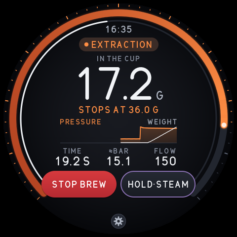

# Meraki+ — a community UI for the round display of MerakiTech espresso machines

[](https://github.com/thomasgrastein/merakitech-plus/actions/workflows/ci.yml)


<p align="center">
  
  
  
</p>

**Meraki+** is an open-source replacement UI for the round 480×480 touch display of the
**MerakiTech Gen 1** espresso machine, and confirmed running on **Gen 2** too (community report — see
[Requirements](#requirements)). It
runs in the display's *slot B* using the manufacturer's own A/B mechanism, so the original software
in *slot A* is never touched, and you can always go back to it with a single command: `./revert.sh`.

---

## ⚠️ Disclaimer — read this before you do anything

**In short: if you install Meraki+, you do so 100 % at your own risk. No warranty, no liability, no
obligation to provide support.** Read the whole section. Only continue if you understand and accept it.

1. **Your own risk, no warranty.** The software is provided "AS IS", without warranty of any kind,
   express or implied, including but not limited to warranties of merchantability, fitness for a
   particular purpose, safety or freedom from defects. See [LICENSE](LICENSE).
2. **No liability.** The author(s) and contributors shall **in no event** be liable for any damage —
   direct, indirect, incidental or consequential — to the machine, property, data, persons or
   anything else arising from the use of, or inability to use, this project, whether or not such
   damage was foreseeable. Where the law of your country does not allow such a limitation of
   liability, it applies to the greatest extent permitted.
3. **Warranty and consumer rights.** Modifying the machine's software **may void the
   manufacturer's warranty** and may affect your statutory consumer rights. Consider waiting until
   the warranty has expired. Before service or a return, restore the original software
   (`./revert.sh`) so the machine is in its original state, and answer truthfully if you are asked
   whether it has been modified.
4. **Risk of "bricking" and data loss.** Meraki+ is designed to be careful (backup before every
   change, md5 checks, atomic file replacement, no reboots, slot A is never touched) — but software
   has bugs, and hardware variants exist. In the worst case a bug could leave the display without a
   working UI, corrupt settings, or require electronic recovery (UART/flash). There is no guarantee
   that recovery will be possible.
5. **Electrical safety — danger to life.** The espresso machine runs on **mains voltage**
   (100–120 V or 220–240 V, depending on the model) and has pressurized boilers with boiling water
   and steam. **You do not need to open the machine** to use
   Meraki+ (installation happens over the network). If you open it anyway (e.g. for UART
   troubleshooting): **unplug it and wait until it has cooled down and discharged**, and only do so
   if you are qualified. Working on mains-powered equipment may be illegal for unlicensed persons in
   your country.
6. **No affiliation.** This project is **not** affiliated with, endorsed, sponsored or supported by
   **MerakiTech**, by the manufacturer of the display module (Sanbon) or by **Cisco Meraki** (a
   completely different company — the name "Meraki+" refers only to the coffee machine). All
   trademarks and product names belong to their respective owners and are used only to describe
   which product the software is made for.
7. **No manufacturer software in this repository.** The repository contains **only** original work
   (source code, our own builds, simulator, documentation). The manufacturer's firmware, binaries,
   libraries and scripts are **not** included, are not distributed and are **not** covered by this
   project's license.
8. **The manufacturer's updates (OTA) are unsigned and can overwrite Meraki+.** The machine's vendor
   OTA can install new firmware into slot B and/or change the boot flag — i.e. replace Meraki+ or
   switch to/from the stock UI without asking. If you want to keep Meraki+ permanently
   (`--persist`), it is recommended to **block the vendor's OTA domain** (`oss.sanbontft.com`) in
   your router/DNS. That also means you will not receive the manufacturer's fixes — your choice,
   your risk. See [Security and OTA](#security-and-ota).
9. **The machine's network security is poor out of the box.** The display runs an **open root
   telnet server without a password** on port 23 (that is how Meraki+ is installed — Meraki+ does not
   open it, it is already there). Anyone on your network can therefore take full control of the
   display. **Put the machine on a separate IoT network/VLAN and block access from outside.**
   Meraki+ does not close this hole.
10. **Reverse engineering and legality.** The protocol documentation was produced by reverse
    engineering a machine owned by the author, for the purpose of interoperability. Whether — and to
    what extent — this is legal depends on the law of your country (e.g. Article 6 of the EU
    Software Directive vs. other jurisdictions). **It is your responsibility to comply with the law
    where you live** and with any license terms you have accepted.
11. **Pressure and weight readings are estimates.** The pressure figure (≈bar · EST.) is a linear
    estimate based on a single anchor point, not a calibrated measurement. Do not use it for safety
    assessments. Meraki+ does not change the firmware of the machine's controller (MCU), which keeps
    its own fault handling. The controller does not check the range of the settings a display sends
    it, however, so Meraki+ enforces the stock UI's limits itself, and a bug in Meraki+ could send a
    value outside them. See [docs/safety.md](docs/safety.md).

By downloading, installing or using Meraki+ you confirm that you have read and accepted the above.

---

## Contents

- [What is Meraki+?](#what-is-meraki)
- [Features](#features)
- [Requirements](#requirements)
- [Quick install](#quick-install)
- [Usage](#usage)
- [Remove Meraki+ (revert)](#remove-meraki-revert)
- [Security and OTA](#security-and-ota)
- [Troubleshooting / FAQ](#troubleshooting--faq)
- [How it works](#how-it-works)
- [Screenshots](#screenshots)
- [Development, contributing and security issues](#development-contributing-and-security-issues)
- [License and trademarks](#license-and-trademarks)

## What is Meraki+?

The MerakiTech machine has two computers: a **controller (MCU)** that drives the boilers, pump,
grinder and scale, and a **display module** (Linux, ARMv7) that shows the UI and sends commands to
the controller over a serial link. Meraki+ replaces **only the display's UI program**. The
controller's firmware and all of its safety functions are unchanged — Meraki+ speaks the same
protocol as the original UI and only sends commands that the original UI also sends (documented and
tested frame by frame, see [docs/protocol.md](docs/protocol.md)).

The display module has two "slots": **A** (`/customer`, the original UI) and **B**
(`/new_customer`, intended for the manufacturer's updates). A flag file selects which one starts.
Meraki+ is placed in **slot B** — slot A is never touched, so the original UI is always intact and
available to go back to.

## Features

- **Touch-first design for the round display** — built for the 480×480 circle: large gauge, large
  numbers, hold-to-start (650 ms) on GRIND / BREW / WATER / STEAM, so nothing starts by accident.
- **Settings parity with the stock UI** — brew temperature, pre-infusion, auto weight, steam, hot
  water, brightness, sound, language, time and more (24 config rows on 3 pages, plus Meraki+'s own UI language, pre-heat and auto-off rows), with the same limits
  as stock, saved in the stock format (so the stock UI reads them afterwards) and with a backup
  before every change.
- **Manual STOP** for **water, grind and brew** (and steam) — the red button during an activity.
  The stop commands are the same as the controller's own, with confirmation once the controller
  reports the stop.
- **One page per function** — tap the grind / brew / water / steam icon to see that function's live values
  and settings and a labelled **HOLD TO START**; the icons on HOME show what they will do (*18.5 G*, *36 G*, …).
- **Live brew view** — weight in the cup, time, flow and a **pressure estimate** (≈bar); a
  calm graph (median + EMA) and a weight dead band, so the numbers do not flicker.
- **Steam while you brew** (v6.20) — during a shot, hold **HOLD·STEAM** next to STOP BREW to start the
  milk steam at the same time. The controller runs both, keeps its own heater limits (only one heater at a
  time) and stops each one by itself: the shot by weight, the steam at the milk temperature; each has its
  own STOP. Steam pressure is a bit lower while the shot runs
  ([details](docs/concurrent-brew-steam.md)).
- **Hot water by weight or manual** (v6.22) — on a controller that can weigh hot water (firmware **> 5.1.2**,
  e.g. 5.1.4) WATER stops by itself at the set weight, as in the stock UI; with *WATER MODE = MANUAL* — or on an
  older controller, where Meraki+ offers **manual hot water only** (exactly the stock UI's rule) — it runs until
  you tap **STOP WATER**. Meraki+ reads the controller's version from the normal status poll and shows it under
  *SYSTEM → DIAGNOSTICS → CONTROLLER* ([details](docs/water-dosing-compat.md)).
- **Center-hold gesture (optional, `--gesture`)** — hold one finger in the middle of the stock UI's
  screen for 5 seconds to switch to Meraki+ without a reboot (works from the first boot after
  installation). To go back: *gear → SYSTEM → STOCK UI → SWITCH TO ORIGINAL NOW*.
- **The power button** is honored — but see the [hardware limitation](#the-power-button-hardware-limitation).
- **Clock, planned pre-heat and auto off** — the time on HOME (12/24 h as in the stock UI), a daily /
  weekday / one-time **pre-heat** that wakes the machine through the controller's own alarm, and
  **auto off** after 30 minutes without use by default, like stock (15 / 20 / 60 or off selectable). See [Clock and pre-heat](#clock-and-pre-heat).
- **Sounds: a start jingle and one ready tone per boiler** — you hear when the **brew boiler** is ready and,
  with a different tone, when the **steam boiler** is (the stock UI plays one sound once both are). Meraki+'s own
  short tones, at the stock *volume*; *SYSTEM → DISPLAY · SOUND* turns them off, picks which boiler announces itself,
  or uses the display's own stock sounds. See [Sounds](#sounds).
- **Boot selection in the UI** — *SYSTEM → STOCK UI → BOOT UI* selects whether the machine starts Meraki+ or the
  original UI.
- **DIAGNOSTICS** (advanced, behind SYSTEM — or one tap on HOME's error line) — connection, error codes
  E1–E3, version, controller firmware, boot slot, network status, raw counters.
- **English and Danish** (switch under *SYSTEM → DISPLAY · SOUND → UI LANGUAGE*).
- **Simulator + E2E tests** — the whole UI can run without a machine against a simulated controller
  (`sim/`), and CI runs the tests on every change.

## Requirements

| | |
|---|---|
| **Machine** | MerakiTech **Gen 1** or **Gen 2** with the round touch display (on Gen 1: display module Sanbon SAT62091M, Linux 4.9). Developed and hardware-verified on one Gen 1. **Gen 2: confirmed running** — a Gen 2 owner installed v6.23 and it runs healthy (community report, [issue #1](https://github.com/thomasgrastein/merakitech-plus/issues/1)); detailed hardware verification (register map, controller firmware, error bits) is still Gen 1 only. On every machine the installer checks a fingerprint and stops without changing anything if the display does not look as expected. Please report your results in an issue. |
| **Designed and tested against** | Controller (MCU) firmware **V5.1.4** (`MEM03_V514_260923`) and the stock display app build **1.1.1-69** — the versions on the reference machine. Every frame Meraki+ sends was reverse-engineered from and verified against these two. Other controller versions: hot water by weight is used only when the controller reports a version **> 5.1.2** (the stock UI's own rule); older or unreadable versions get manual hot water. Nothing else has been tested on other firmware — please report your *DIAGNOSTICS → CONTROLLER* version in an issue. |
| **Network** | The machine on your Wi-Fi (set up in the stock app/UI), and your computer on the **same local network**. |
| **Computer** | macOS or Linux (Windows: use WSL) with `bash`, `python3` ≥ 3.8 and `git`. Nothing else. |
| **The machine's IP address** | Find it in your router's list of devices, or let the installer find it with `--scan`. |
| **For development (optional)** | [zig](https://ziglang.org/download/) 0.17 to build from source — see [CONTRIBUTING.md](CONTRIBUTING.md). |

## Quick install

```sh
git clone https://github.com/thomasgrastein/merakitech-plus.git
cd merakitech-plus
git checkout "$(git describe --tags --abbrev=0 origin/main)"   # the latest release tag (a signed release)

./install.sh --scan                      # 1. find the display on your network (or look in your router)
./install.sh --ip 192.168.1.50 --dry-run # 2. see exactly what will happen — changes nothing
./install.sh --ip 192.168.1.50           # 3. install and start Meraki+ (no reboot)
```

(Replace `192.168.1.50` with your display's address.) The installer is **signed by default**: it installs only files
that match the maintainer's signed release manifest, so install from a release tag as above — a checkout of `main`
between releases is a development build and is refused unless you pass `--allow-unsigned`
([Security and OTA](#security-and-ota)). **Make sure the machine is idle** — no brewing,
steaming, grinding or hot water — while you install. The installer asks before it changes anything.

**What the installer does, step by step:**

1. **Checks the display (read-only)** — fingerprint (A/B layout, ARMv7, slot B mounted), what is
   running, which slot starts at boot, free space (for updates too), and traces of a manufacturer
   update (see *Security and OTA*).
2. **Fetches and verifies the binary** — from your local `bin/` (git clone) or GitHub, always
   checked against the expected SHA-256 and md5. Anything else is rejected.
3. **Takes a backup once** — slot B's existing program and `/customer/demo.sh` are copied and
   md5-verified. Backups are never overwritten by later runs.
4. **Installs into slot B** — the new version goes complete into its own release directory
   (`/new_customer/merakiplus/rel/<version>-<sha>/`: the UI, the sound player, the sounds and a
   `MANIFEST`): every file is uploaded to a temp file, md5-checked (plus SHA-256 when the display has
   `sha256sum`) and synced to flash, and only then is the directory renamed into place in one step — a
   power cut leaves the complete old or the complete new version, never a mix. A small **launcher**
   (checked by its own selftest on the display first) becomes `/new_customer/demo_v9`; it starts the
   version named by a state file. Updating from v6.20 or older keeps the running version as the
   rollback target. Temp files left by an interrupted run are removed.
5. **Optional** — `--gesture` (the gesture switcher; adds **one** line to `demo.sh`) and
   `--persist` (sets the boot flag). Without these, neither `demo.sh` nor the flag is touched.
6. **Activates without a reboot** — a running Meraki+ (v6.21 or newer) restarts itself into the new
   version as soon as the machine is idle on HOME (never during a brew, steam, grind or hot water);
   older versions are switched via the manufacturer's own watchdog (exec reload) or by a "stop-first"
   switch: the original UI is paused, Meraki+ is started and verified, and only then is the original
   stopped. If anything goes wrong, the original UI is resumed automatically.
7. **Verifies and health-checks** — the right version runs with the correct md5 and slot A is
   unchanged; then Meraki+ itself must report **healthy** (running 60 s, the coffee machine's
   controller answering). Then the new version is committed. Until then it is a **trial**: if it
   does not become healthy within 3 starts, the launcher goes back by itself — to the previous Meraki+
   version, and if that fails too, to the original UI (which brings Wi-Fi back, so you can always
   reach the display). Finally it prints the revert command.

**Options:**

| | |
|---|---|
| `--ip ADDR` / `--scan` | the display's address / find it automatically (`--subnet 10.0.0.0/24` for another network). Only scan a network you own or administer. |
| `--dry-run` | show every step, change nothing |
| `--persist` | start Meraki+ at **every** boot (sets the boot flag `/customer/new`) |
| `--gesture` | install the center-hold gesture (stock → Meraki+ without a reboot) |
| `--no-activate` | install, but do not start Meraki+ now |
| `--yes` | do not ask (for scripts) |
| `--verbose` | show every command sent to the display |
| `--allow-unsigned` | developers: install files that are not a signed release (refused on a display that already has a signed release unless `--allow-downgrade` is added) |

The installer is **idempotent**: run it again to update to a new version, or to start Meraki+ again
after a reboot (without `--persist` the machine starts the original UI at boot). A log is saved in
`logs/`. Status without changing anything: `python3 tools/merakiplus.py status --ip ADDR`.

**Installed with a release from before 2026-11-19 (v6.16 or earlier)?** Those releases used an older
install directory under `/new_customer/`. Running `./install.sh` (or `./revert.sh`) again migrates it
automatically: backups, state, gesture switcher, language file, pre-heat schedule and settings backups
are moved to `/new_customer/merakiplus/`, the `demo.sh` guard line is updated (or removed by revert), and
the older Meraki+ build is still recognised as Meraki+. Nothing is lost; `--dry-run` shows the steps.

<details>
<summary><b>Installing without git (curl) — not recommended</b></summary>

```sh
curl -fsSL https://raw.githubusercontent.com/thomasgrastein/merakitech-plus/main/install.sh | bash -s -- --ip 192.168.1.50
```

The script installs the **latest published release**: it looks up that release tag on GitHub and fetches the
installer and the binaries from the tag, never from a branch; the binaries are then checked against the pinned
hashes and the release's signed manifest. The installer itself is not verified by anything but GitHub's TLS, and you
cannot read it before it runs. **Prefer `git clone`** of a release tag, read the script, and run `--dry-run` first.
`MERAKIPLUS_REF` may name another release tag (`v6.23`) or a full commit SHA, nothing else. `revert.sh` requires a
clone of the repository.
</details>

## Usage

| What | How |
|---|---|
| **Start an activity** | **Hold** one of the four icons (grind · brew · water · steam) for ~0.7 s — the number under the icon is what it will do. Or **tap** the icon to open its page and hold **HOLD TO START** there. |
| **Stop an activity** | Tap the big red **STOP** button (*STOP WATER / STOP BREW / STOP GRIND / STOP STEAM*). Green message = the controller has confirmed the stop. Yellow/red message = try again. Auto-stop at the target weight works as in the stock UI. |
| **Hot water** | *WATER MODE = AUTO* (controller > 5.1.2): stops by itself at the *HOT WATER* weight. *MANUAL* — and always on an older controller (the WATER page then says *MANUAL HOT WATER* and has no weight rows) — runs until you tap **STOP WATER**; there is no time limit, exactly as in the stock UI. |
| **Get around** | **Tap an icon** = that function's page (GRIND · BREW · WATER · STEAM: live values + its settings). **Tap the gear** = SYSTEM (DISPLAY · CLOCK · SCHEDULE · STOCK UI · DIAGNOSTICS; tap a section to open it). **Back** = the arrow at the top of every page, or swipe right. |
| **Change a setting** | Open the function's page (or SYSTEM) → tap the row → `−`/`+` (hold to go fast) → **SAVE**. Swipe down or tap the arrow at the top to cancel. |
| **Language** | *gear → DISPLAY → UI LANGUAGE* (English/Danish; the DISPLAY row shows the current language). The stock UI's language is set separately (*STOCK UI → STOCK LANG.*). |
| **Back to the original UI now** | *gear → STOCK UI → SWITCH TO ORIGINAL NOW* (no reboot). |
| **To Meraki+ from the original UI** | With `--gesture`: hold **one finger still in the middle of the screen for 5 s** and release (active from the first boot after installation, because the gesture switcher is started by `demo.sh`). Without it: run `./install.sh --ip ADDR` again. |
| **What starts at boot** | *gear → STOCK UI → BOOT UI* (takes effect at the next boot), or `--persist` / `./revert.sh`. |
| **Something is wrong** | HOME says what (*BREW BOILER SENSOR FAULT*, *NO CONNECTION TO THE MACHINE*); tap the line under it (*TAP FOR DETAILS*) for DIAGNOSTICS. |

### Clock and pre-heat

- **Clock:** HOME's top line shows the local time: the display's system clock (UTC) + the time zone set in
  the stock UI + daylight saving if *SYSTEM → CLOCK → DAYLIGHT SAVING* is on. *TIME FORMAT* 24-HOUR / 12-HOUR
  matches the stock UI's setting. Meraki+ does not set the clock itself; if it has never been set (no network
  time sync in the stock UI yet), the wordmark is shown instead.
- **Pre-heat:** *SYSTEM → SCHEDULE → PRE-HEAT* (on/off), *PRE-HEAT AT* (time) and *REPEAT* (once / every day / Mon–Fri /
  Sat–Sun). When the machine is switched off, the next pre-heat is handed to the controller as its wake alarm —
  the same way the stock UI does it — and the controller wakes and heats at that time. HOME shows the next
  pre-heat while it is planned. Meraki+'s schedule is separate from the stock UI's schedules.
- **Auto off:** *SYSTEM → SCHEDULE → AUTO OFF* (off / 15 / 20 / 30 / 60 min; **30 min by default**, like the stock
  UI — since v6.23). After that long without a touch or an activity the machine switches off (a warning appears 30 s
  before; touch the screen to stay on). An install that already had AUTO OFF saved as *off* keeps it off
  ([details](docs/time-scheduling.md#51-default-and-migration-v623)).

Details: [docs/time-scheduling.md](docs/time-scheduling.md).

### Sounds

- **Start jingle** (a warm marimba-and-bell arpeggio) once each time the machine is switched on, then **one tone per
  boiler** as it heats up to its temperature: a low wooden marimba double note for the **brew boiler**, a bright
  glockenspiel triple pip for the **steam boiler**. If a boiler is **already hot** when you switch on (or wake the
  machine), it stays quiet — you hear only the jingle. A boiler announces itself again only after it has really cooled
  down (not after a shot or a steam session). Nothing plays while the machine is off or asleep, and a tone that comes
  due while you brew or steam is skipped.
- *SYSTEM → DISPLAY · SOUND*: **SOUND** off / on / stock sounds, **READY TONE** off / brew boiler / steam boiler /
  both boilers, **VOLUME** (the stock UI's volume, shared; 0 = silent). SAVE plays a short test tone.
- The tones are Meraki+'s own (`audio/`, generated by `tools/gen_audio.py`); they are played through the display's
  own audio driver by the small helper `merakiplus_snd`, which the installer puts next to Meraki+.
  *DIAGNOSTICS → SOUND* shows the last sound. Details and the reversed stock audio path: [docs/audio.md](docs/audio.md).
  The speaker path is confirmed on a machine (v6.18.1); the v6.19 sounds have **not yet been heard on a machine** —
  feedback welcome.

### The pressure estimate

The machine's protocol does not provide a calibrated pressure value. Meraki+ therefore shows
pressure as an **estimate**: the raw value from the controller is scaled linearly so that the
pre-infusion level matches the pre-infusion pressure set in the settings (default 4 bar). The value
is labelled *≈BAR*; tap the graph to see the basis. Use it as a trend, not as a measurement.
Details: [docs/calibration.md](docs/calibration.md).

### The power button (hardware limitation)

Meraki+ implements the stock UI's power-off/power-on sequence byte for byte — but on the tested
hardware the software never gets a chance to react to a long press:

- **If you hold the button for ~0.8 s**, the display module's kernel/power management (PMIC) cuts
  the power by itself. That is a **power loss for the display**, not a clean shutdown — exactly as
  with the original UI.
- **When the machine is switched on again, it is a cold boot** (the display boots from scratch).
- When the controller goes to sleep, it also cuts power to the display (~8 ms after the power-off
  command).
- A state of "off, but the display is alive and reachable over the network" is therefore **not
  possible** on this hardware. No data is lost because of this (Meraki+ only writes files
  atomically), but avoid switching off while you are saving a setting.

Details and evidence: [docs/power.md](docs/power.md).

## Remove Meraki+ (revert)

```sh
./revert.sh --ip 192.168.1.50 --dry-run   # see what will happen
./revert.sh --ip 192.168.1.50             # remove Meraki+ and start the original UI (no reboot)
./revert.sh --ip 192.168.1.50 --purge     # ... and also delete backups, language file and settings backups
```

Revert immediately switches back to the original UI (stop-first), restores `demo.sh` (byte-identical
to the backup), removes the gesture switcher, restores slot B's original program (or leaves slot B
empty if it was empty), and resets the boot flag to what it was before Meraki+. It can be run as many
times as you like.

**Settings:** changes you saved in Meraki+ are stored in `config.json` in the stock format and remain
in effect in the original UI — that is intended. Meraki+ takes a backup before every change in
`/new_customer/merakiplus/cfgbak/` (only deleted with `--purge`).

**Cannot reach the display over the network?** Unplug the machine for 10 s and plug it back in.
Without `--persist` the machine starts the original UI. With `--persist`: see the manual procedure in
[docs/boot.md §5.2](docs/boot.md).

## Security and OTA

- **Telnet:** out of the box, the display module has an open root shell (telnet, port 23, no
  password). Put the machine on a **guest/IoT network**, do not allow inbound connections from
  outside, and consider restricting port 23 to your own computer in the router. This is a
  vulnerability in the manufacturer's firmware — report it to the manufacturer, not to this project.
- **Vendor OTA:** the manufacturer's updates are downloaded unencrypted/unsigned and installed into
  the slot that is *not* running, after which the boot flag is switched. Consequences: an OTA can
  **overwrite Meraki+ in slot B**, **remove the gesture line** in `demo.sh` or **switch the boot
  slot**. If you want to keep Meraki+ permanently, block `oss.sanbontft.com` in your router/DNS (and
  optionally `pro.ip-api.com`, which the stock UI contacts). `./install.sh --ip ADDR` (and the
  read-only `python3 tools/merakiplus.py status --ip ADDR`) **detect** the traces of a manufacturer
  update — a downloaded update waiting for the next boot, slot B or `demo.sh` replaced, slot A
  changed, the boot flag cleared — and say so. After an OTA: run `./install.sh` again with the options
  you used before (optionally `./revert.sh` first).
- **Rollback:** since v6.21 a crashing or unhealthy new version is rolled back automatically on the
  display (previous version → original UI), without a computer or network.
  Meraki+ also shows a notice on screen (SYSTEM and a toast) when it finds a manufacturer update.
- **Signed releases:** from v6.23, every release carries `manifest.json` + `manifest.sig` — all files
  with SHA-256, signed offline by the maintainer with an Ed25519 key (id `26f673cde8584ba0`) that CI and GitHub
  never see, after reviewing every change since the last signed release and a byte-for-byte rebuild. CI only builds
  a *draft*; a release becomes public when the maintainer signs and publishes it, and published releases are
  immutable. `./install.sh` is **signed by default**: it checks the signature and every file on your computer before
  it changes anything on the display, refuses unsigned or modified files (`--allow-unsigned` for development builds),
  and refuses older signed releases than the display already had (`--allow-downgrade` to do it on purpose). Check a
  download yourself: `python3 tools/merakiplus.py verify-release <dir>`. Details and the key:
  [docs/signing.md](docs/signing.md).
- **Trust root:** a signature can only be checked with a key you already trust. The first download of the installer
  trusts GitHub and this repository; a clone you keep (and update only to release tags you choose) keeps its own
  pinned key and is not affected by later changes to the repository. How releases are made and what CI may do:
  [docs/release-process.md](docs/release-process.md).
- **Planned:** an opt-in update check on the display itself — see [docs/ota-plan.md](docs/ota-plan.md)
  (phases 1a, 1b and 2 are done; on-device download is not implemented yet).
- **Meraki+ itself** opens no new network ports and contacts no servers. Its only network function
  is bringing up the display's Wi-Fi at boot from slot B (the same configuration the stock UI uses;
  the password is never logged).
- Found a security bug in Meraki+'s own code? See [SECURITY.md](SECURITY.md).

## Troubleshooting / FAQ

<details><summary><b>"Cannot reach …:23"</b></summary>

The machine must be switched on and on the same network. Check the IP address in your router, try
`./install.sh --scan`, and check that your computer is not on a guest network that isolates devices.
</details>

<details><summary><b>"This does not look like a MerakiTech/Sanbon display"</b></summary>

The fingerprint does not match (different hardware/firmware). The installer has not changed
anything. Open an issue with the output of `python3 tools/merakiplus.py status --ip ADDR` (remove the
IP address yourself).
</details>

<details><summary><b>The display showed the original UI again after a power cut</b></summary>

Expected without `--persist`. Run `./install.sh --ip ADDR` again, use the gesture (`--gesture`), or
select *BOOT UI = Meraki+* on Meraki+'s SYSTEM page.
</details>

<details><summary><b>Meraki+ shows "OFFLINE" / no connection to the controller</b></summary>

The controller may be asleep. Briefly press the power button. If it stays offline, switch to the
original UI (*SWITCH TO ORIGINAL NOW*) and see whether it works there; otherwise open an issue with a
photo of the DIAGNOSTICS page.
</details>

<details><summary><b>An activity will not start</b></summary>

Hold the icon for ~0.7 s (a short tap opens the function's page instead). The line under the page's
title says why a start is blocked. If it says *OUT OF SPEC*, a setting is outside the stock UI's
allowed range — the row is marked red on that page; open it and pick a value.
</details>

<details><summary><b>Can I break the coffee machine?</b></summary>

Meraki+ does not change the controller's firmware and only sends the commands the original UI also
sends (with the same limits, CRC and acknowledgement). The risk lies mainly in the display module's
software — see the disclaimer. No guarantees are given.
</details>

<details><summary><b>Does it work on 120 V / 60 Hz (US/Canada)?</b></summary>

Meraki+ does not depend on the mains voltage; that is decided by the machine. A 100–120 V machine
(sold by the US/CA store) runs normally on 120 V / 60 Hz. A 220–240 V machine stops at power-on with
an E1 mains-voltage error. The machine is not dual-voltage. One caveat: the ≈BAR pressure estimate is
anchored on a 230 V machine and reads about 25 % high on a 120 V machine. Details, firmware evidence
and what to check: [docs/mains-voltage.md](docs/mains-voltage.md).
</details>

<details><summary><b>Does it work on Gen 2?</b></summary>

Yes — confirmed running. A Gen 2 owner installed v6.23 and reported it running healthy (community report,
[issue #1](https://github.com/thomasgrastein/merakitech-plus/issues/1)). Detailed hardware verification is still Gen 1 only: whether Gen 2's controller firmware and
register map match Gen 1 in every detail has not been checked, so some messages may differ (for example the
water-tank error bits, still awaiting Gen 2 values in issue #1). The installer still checks the display's fingerprint
on every machine — run `--dry-run` first; it stops without changes if the display is not recognized. Please share your
result (and your *DIAGNOSTICS → CONTROLLER* version) in an issue.
</details>

## How it works

```
 /customer/          slot A — original UI (demo_v9), NEVER touched by Meraki+
 /new_customer/      slot B — Meraki+'s launcher is installed here as demo_v9
   merakiplus/rel/   one directory per version (UI, sound player, sounds, MANIFEST): current + previous
   merakiplus/ota/   the launcher's state (current / previous / trial) and its log
   merakiplus/boot/  backups (demo_v9.vendor, demo.sh.bak), install state, gesture switcher
   merakiplus/       own settings (lang, schedule, sound)
 /customer/new       boot flag: if present, slot B starts at boot (only with --persist)
 /customer/test.sh   the manufacturer's watchdog: restarts "demo_v9" if it disappears
```

The manufacturer's watchdog only checks that a process named `demo_v9` is running. Meraki+'s launcher
is therefore called `demo_v9` in slot B; it starts (exec, same process) the chosen version, which is
also called `demo_v9`, so a new version can be activated without a reboot and a failing one is rolled
back at the next start ([docs/ota-plan.md](docs/ota-plan.md) phase 1b). The full
description (including the gesture, the watchdog race and the OTA table) is in
[docs/boot.md](docs/boot.md).

| Document | Contents |
|---|---|
| [docs/protocol.md](docs/protocol.md) | The UART protocol display ↔ controller (frames, CRC, commands) |
| [docs/registermap.md](docs/registermap.md) | The controller's 129 register words |
| [docs/ui-guide.md](docs/ui-guide.md) | Pages, touch zones and settings in Meraki+ |
| [docs/boot.md](docs/boot.md) | A/B boot, watchdog, gesture switcher, OTA, manual revert |
| [docs/gesture.md](docs/gesture.md) | The center-hold gesture and the grab bypass |
| [docs/power.md](docs/power.md) | The power button: verification and hardware findings |
| [docs/time-scheduling.md](docs/time-scheduling.md) | Clock, 12/24 h, planned pre-heat (the controller's wake alarm) and auto off — stock semantics with addresses |
| [docs/audio.md](docs/audio.md) | The stock UI's audio path (MI_AO, mm_player, the jingle and "pre-heat complete") and Meraki+'s per-boiler tones |
| [docs/calibration.md](docs/calibration.md) | Pressure estimate, graph and weight conditioning |
| [docs/presets-spec.md](docs/presets-spec.md) | *Planned:* presets (named recipe sets) — model, own file, UI, NDEF tag format; stock's preset system reversed |
| [docs/nfc-plan.md](docs/nfc-plan.md) | *Planned:* the NFC reader reversed (bus, chip, stock tag format and flow) and the phased NFC plan |
| [docs/concurrent-brew-steam.md](docs/concurrent-brew-steam.md) | *Feasibility:* brewing and steaming at the same time — MCU/stock/Meraki+ evidence, sim result, hardware runbook |
| [docs/integrations.md](docs/integrations.md) | *Design, not implemented:* a read-only data feed — shot records, local journal, MQTT and Home Assistant discovery; reach ranking, security review, coexistence with Meraki Companion |
| [docs/ota-plan.md](docs/ota-plan.md) | *Planned:* secure updates — storage/tooling/vendor-OTA inventory, signed manifests, boot launcher with automatic rollback, phases and tests |
| [docs/water-dosing-compat.md](docs/water-dosing-compat.md) | Hot water by weight needs controller firmware > 5.1.2 — how the stock UI detects it (words 80..87), how Meraki+ gates it and its manual hot water (v6.22) |
| [docs/mains-voltage.md](docs/mains-voltage.md) | 120 V / 60 Hz vs 230 V / 50 Hz — the controller's `set_voltage` modes, the E1 boot check, vendor specs, the pressure-estimate caveat |
| [docs/safety.md](docs/safety.md) | Safety notes — what Meraki+ can and cannot command, where it differs from the stock UI (auto off, pre-heat, manual hot water), what is untested |
| [docs/dev/](docs/dev/) | Developer notes (full UI spec with changelog, parity analysis) |
| [sim/README.md](sim/README.md) | The simulator and the E2E tests |

## Screenshots

From the simulator (the same code as on the machine):

| | | |
|---|---|---|
|  |  |  |
| HOME, ready (English) | The BREW page (tap the cup icon) | Brewing (STOP BREW · HOLD·STEAM) |
|  |  |  |
| Steam | SYSTEM (the gear) | SYSTEM › SCHEDULE |
|  |  |  |
| Brew temperature | DIAGNOSTICS | HOME (Danish UI) |
|  | | |
| SYSTEM › DISPLAY · SOUND (v6.18) | | |

## Development, contributing and security issues

- Build, test and simulate: [CONTRIBUTING.md](CONTRIBUTING.md) (`./build.sh`, `python3 sim/selftest.py`,
  `python3 sim/run_e2e.py --all --quick --parallel 4`, `python3 tests/test_installer.py`).
- Contributions arrive as **pull requests** against `main`: CI's `merge-gate` check must be green (the full E2E
  suite for code changes) and a maintainer approves — see [How changes reach `main`](CONTRIBUTING.md#how-changes-reach-main).
  Releases are cut by merging a version bump: [docs/release-process.md](docs/release-process.md).
- Changes: [CHANGELOG.md](CHANGELOG.md). Code of conduct: [CODE_OF_CONDUCT.md](CODE_OF_CONDUCT.md).
- Security issues: **not** as a public issue — see [SECURITY.md](SECURITY.md).
- The shipped binaries and their md5 sums: [bin/README.md](bin/README.md).

## License and trademarks

The project's own code and documentation are released under the [MIT License](LICENSE). The license
does **not** cover the manufacturer's firmware or software, which is neither included nor licensed
here. "Meraki", "MerakiTech" and other names mentioned are trademarks of their respective owners;
"Cisco Meraki" is a trademark of Cisco Systems, Inc. and has nothing to do with this project.

If you are a rights holder and have a concern about this project, please contact the maintainer
directly (the address is in [SECURITY.md](SECURITY.md)) — you will get a prompt answer.
