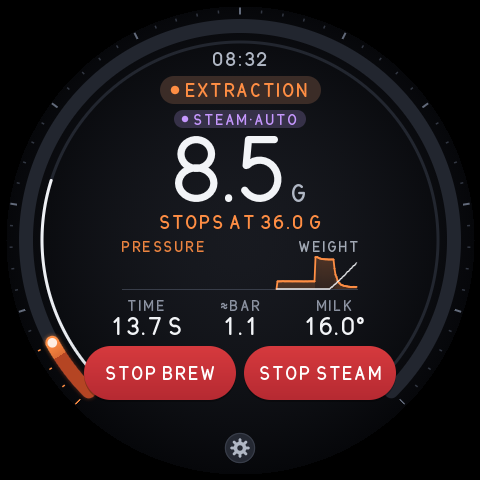
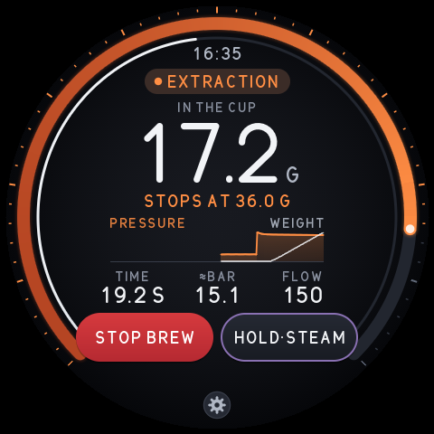

# Brewing and steaming at the same time — feasibility

> **Status: implemented in v6.20 (§12).** During a brew the brew screen offers **HOLD·STEAM** next to STOP BREW; holding it
> starts a latched steam session on top of the brew. §1–§11 are the feasibility study and the hardware verification that led
> to it; they describe the state *before* v6.20 where they say "Meraki+ today".

**Date:** 2026-11-22 · **Method:** static analysis of the MCU firmware (`MEM03_V514_260923.bin`, Nuvoton M451) and the
stock display UI (`demo_v9`), a re-analysis of the existing live UART capture (the STEAMLIVE session, 2026-11-17), and a new
sim scenario. The static/sim round had no device access; the hardware runbook (§8) was **executed on the real machine later
the same day — see §11 (PASS)**. This round changed no code; the only additions are this document and one sim scenario.

## 1. Verdict

| Question | Answer |
|---|---|
| Can the MCU run a full latched steam session (word 24 = 1, milk auto-stop) while a brew runs? | **Yes. There is no brew↔steam lock in the MCU**, and the heater task has a branch written for exactly this case (§3.4). |
| Does the hardware share anything critical? | **The pump is shared, but steam does not use it.** Steam = boiler pressure + the wand solenoid (PE.6). Brew = pump + inlet valve + group valve. They use different outputs (§2). |
| Power / thermal? | **Handled by the MCU.** Its heater task never runs both heaters at once, and it switches the brew-boiler heater off while a brew runs. During brew + steam the only heater allowed on is the steam heater, and only once the steam boiler has fallen 10 °C below its target (§3.4). Peak load ≈ steam heater + pump (§4). |
| Does the stock UI allow it? | **Yes — proven on hardware (§11).** The brew screen's back button reaches HOME, the steam start latches during a brew, and `dealBrewAndSteam` / `brewAndSteamRuningPlay` show a combined view with live brew weight + milk temperature. |
| Does Meraki+ allow it? | **Since v6.20: yes, steam during a brew (§12).** Up to v6.19 `act_guard()` refused every start while any activity ran (toast *ACTIVITY IN PROGRESS*) and sent nothing (§6). Showing both was already correct: EXTRACTION + STEAM·AUTO and two STOP buttons (sim, §7). |
| Sim | **Allows it:** 26/26 PASS (EN and DA). Each activity stops on its own (§7). |
| Easy to enable? | **Yes, and hardware-confirmed (§11): small UI change, nothing to change in the MCU.** Relax one guard and add a "start steam" button to the brew screen (§9). The hardware session is done. |

**What actually blocks it today: only Meraki+'s own activity guard.** The MCU's real locks are elsewhere: the grinder blocks
brew and steam, and the cleaning program blocks both (§3.2).

## 2. Who drives what (work_sta word 33 → outputs)

The run task at `0x2782` copies each work_sta bit to one output pin (REGISTERMAP §2.9). Bits 12 and 14 drive no pin; nothing in the firmware reads bit 14.

| Bit | Pin | Set by | Meaning (combined from all writers) |
|---|---|---|---|
| 1 | PD.13 | brew (`0x2098` sets `0x1206`), hot water, e-boiler refill (`0x23F8` sets `0x202`) | brew-boiler inlet valve |
| 2 | PD.11 | brew only | group (brew) valve |
| 3 | PD.10 | hot water only | hot-water outlet valve |
| 4 | PD.12 | steam-boiler refill (`0x2384` `#0x210`) | steam-boiler inlet valve |
| 5 | **PE.6** | **steam-ctl only** (`0x2258` `#0x4020`) | **wand solenoid** |
| 9 | PC.1 | brew, hot water, both refills | **pump**. In the run task it is "keep current value"; while `0x2000002D` is set, the TMR23 ISR `0x9896` phase-controls it (pre-infusion). |
| 10 | PC.3 | heater task `0x38CC` | **brew-boiler heater** (time slot) |
| 13 | PA.7 | heater task `0x394E` | **steam-boiler heater** (time slot) |
| 12 / 14 | — | brew / steam | status flags only |

> Correction: STEAMLIVE §3 and the sim call bits 10/13 "boiler refill pulses". The heater task shows they are the **heater
> time slots** (brew boiler / steam boiler). Refill is bits 4+9 / 1+9.

So brew (1, 2, 9, 12) and steam (5, 14) share no output. Steam needs no pump: the steam boiler makes the pressure.

## 3. MCU firmware evidence

### 3.1 One loop, independent controllers
The status task calls the controllers one after another every cycle: `0x28FA` grind `0x19C6` → `0x28FE` cleaning `0x1AE0` →
`0x2904` **brew-ctl `0x1E9C`** → `0x290A` **steam-ctl `0x210E`** → `0x290E` hot water `0x1B8C`. They are not separate RTOS
tasks, so there is no race. Each controller only changes its own bits:
brew sets `0x1206`/`0x1006` and clears `0xEFFB`/`0xFDFD`/`~0x10`; steam sets `0x4020` and clears `0xBFDF` (bits 5+14 only).

### 3.2 What each controller checks before running
| Check | brew-ctl `0x1E9C` | steam-ctl `0x210E` |
|---|---|---|
| word 20 ≠ 0 (cleaning program, `0x1AE0`) | `0x1EF2`: return | `0x2138`: return |
| grinder running (byte `0x20000028`, written by grind-ctl at `0x1ABE`) | `0x1EFE/0x1F2C`: brew aborted | `0x2148/0x2174`: steam stopped |
| E1/E2/E3 masks from the table at `0xF130` | `0x1F04..0x1F4C` | `0x2154..0x219A` |
| **the other activity's bits or words** | **none** | **none** |

The two controllers share a RAM block at `0x20000028`, but in different fields. Brew uses +1, +5, +0xA..+0xD, +0x12.
Steam uses +2, +6, +0xE, +0xF, +0x14, +0x28. Neither reads the other's state.

### 3.3 Steam boiler refill (add_water `0x226E`)
While the wand valve is open (`ws & 0x60`, `0x22BA`), the steam-boiler refill is paused. While a brew or hot-water valve is open (`ws & 0x0C`,
`0x22D6`), refill bit 4 is cleared. Concurrent brew + steam therefore **defers refills until both have finished**. A steam-only session
already behaves this way.

### 3.4 Heater task `0x3502` — the designed brew+steam case
The heater task works in 100-slot windows. It computes a brew-boiler duty r4 and a steam-boiler duty r7. If r4 + r7 ≥ 100 it shares
the window between them (`0x383E..0x3866`). Then it runs the brew-boiler slots (bit 10), followed by the steam-boiler slots (bit 13).
**The two heaters are never on at the same time.**

* Brew-boiler heater is **off** while `ws & 0x2244` (bits 2, 6, 9, 13) (`0x35B4`, `0x389C`). That covers every brew, every grind, and every steam-heater slot.
* Steam-boiler heater (`0x371A..0x37B6`, slot loop `0x3906..0x396C`):
  * **brewing without steam** (bit 2 set, bit 5 clear) → duty 0.
  * **brewing + wand valve open** (bits 2 and 5) and the pre-infusion flag `0x2000002D` clear → a latch r5: duty **100 %** once the steam
    boiler is **below its target − 10.0 °C**. Otherwise 0. With r5 set, the slot loop ignores the brew bits (`0x391C..0x3924`). It still
    stops each slot above the target (`0x390C`).
  * during **phase-controlled pre-infusion** (`0x2000002D` = 1: set by the recipe setup `0x1E10` when preInfusionSwitch is on, cleared at `0x2018`
    when the window ends) → duty 0.
  * Target by steam gear (word 14, `0x36F6..0x3798`): 1 = 120.0 °C, 2 = 125.0 °C, 3 = 130.0 °C, other = 135.0 °C.
* Grinding (bit 6) switches both heaters off.

The r5 branch only exists for "brew and steam valve open together", which suggests the firmware authors planned for this case.
The power budget is one heater plus the pump. The grinder can never run together with a heater.

### 3.5 Steam's own stops still apply during a brew
Steam stops at milk ≥ word 25 (`0x21C8`, latched path only), on a manual word 24 = 0 write, on the elapsed cap word 15 (`0x2238`;
seconds from the 1 Hz RTC tick `0x8DDC → 0x17EE`; Meraki+ and stock boot-push 60), or on E1/E2/E3. Brew stops at its weight target or its own
stop. Neither stop touches the other's bits.

## 4. Live evidence (re-analysis of the STEAMLIVE capture, 12 900 CRC-OK frames)

| Phase | Polls | Bit 13 (steam heater) | Bit 10 (brew heater) | cur1 word 50 min/median/max | Steam boiler word 47 | Mains word 49 |
|---|---|---|---|---|---|---|
| brew #1 extraction | 188 | 0 | 0 | 998 / 1008 / 1553 | 1298 → 1294 | 237–238 V |
| display steam (alone) | 325 | 261 | 26 | 54 / 7333 / 7645 | 1298 → 1249 | 233–238 V |
| brew #2 pre-infusion | 56 | 0 | 0 | 1465 / 1554 / 3098 | 1301 → 1300 | 238 V |
| brew #2 extraction | 115 | 0 | 0 | 1006 / 1016 / 1701 | 1299 → 1295 | 237–238 V |
| **wand flush during brew** (`0x5327`) | 26 | **0** | 0 | 1008 / 1024 / 1027 | **1295 → 1259** | 237 V |

* During a brew **neither heater ever came on**, and cur1 ≈ 1.0 k is the pump alone. That matches §3.4.
* During the 3.1 s flush the steam boiler fell 129.5 → 125.9 °C. That stayed above target − 10 (120 °C), so the steam heater stayed **off**,
  exactly as the r5 rule predicts. Brew weight (216 → 279) and flow continued normally (STEAMLIVE §7).
* Projected peak load for a latched session during a brew: steam heater (~7.3 k) + pump (~1.0 k) ≈ **8.3 k on cur1**, about 10 % above the highest value
  seen in any captured phase (7.6 k). The units of cur1 are not verified. If they are mA, that is ≈ 8.3 A at 237 V.

## 5. Stock UI (`demo_v9`)

* `isExtractionOrSteamSwitchOn` `0x1481E0` = work_sta bit 12 or bit 14, or mirror word 22, 24 or 6. It is used by the sleep/power-off paths
  (`onHandle 0xE5778`, `deal_y 0x122310`, `SleepRefresh 0x1492D4`). It does not gate activity starts.
* **`dealBrewAndSteam` `0x10E744`** (called from the UART `onHandle` `0x10D0FC..`): if steam is active (word 24 or bit 14), it shows a steam indicator.
  When brew bit 12 rises, it calls `videoClose`, then **`brewAndSteamRuningPlay` `0x11D304`**, then `goto_brew_page`. `brewPageDeal` `0x11CEC0` does
  the same, and `dealBrewPage` calls `steamBrewPosColorUpdate`. **Stock has a dedicated combined brew+steam view.**
* Start handlers in `onClick` `0x1088A4`:
  * HOME steam icon `0x10973C`: opens the steam page if steam is idle (bit 14 clear, word 24 = 0). It does not check brew.
  * Steam page start/stop `0x10987C..0x109900`: toggles mirror word 24, `usart_send(6,24,8)`. It does not check brew.
  * Brew button `0x109478..`: one branch *stops steam* (word 24 = 1, word 22 = 0, bit 12 set). The brew start/stop toggle `0x109550..0x109700`
    does not check steam.
* **Proven on hardware (§11):** stock jumps to the brew page when a brew starts, but the brew page's back button returns to
  HOME, from which the steam start latches during the brew. The combined view is shown. There is no stock UI guard against it.

## 6. Meraki+ before v6.20 (`src/merakiplus.c`)

* `act_guard()` (`/* ---- activity guards */`): `if(phase_active(phase_raw(now))) return TR(TX_G_BUSY);`. So a steam start during a brew
  becomes the toast *ACTIVITY IN PROGRESS* and **no frame is sent**. The same guard blocks a brew start during steam. The feature-page HOLD TO START and the
  HOME icon both go through `act_request()`, so the result is the same either way.
* If both run anyway (the wand path, or a write from elsewhere), Meraki+ already handles it. `phase_main()` keeps brew as the main
  activity. `steam_track()` classifies AUTO/WAND. `stop_btns()` shows **STOP BREW + STOP STEAM** side by side. HOME shows the STEAM·AUTO chip
  and the milk temperature (§7 screenshot). The guard comment says "any activity — including a wand flush — blocks start". That is the only obstacle.
* SAVE, SWITCH NOW, power-off and sleep stay blocked while anything runs. Those guards should stay as they are.

## 7. Sim — `sim/scenarios/concurrent_brew_steam.json` (new, `ui_only`)

> This section describes the scenario as written for the feasibility round (v6.19 UI). v6.20 turned it into a real UI start and
> removed both simplifications below — see §12.

The scenario: brew starts (UI) → at t = 9 s the UI tries to start steam → at t = 10.5 s it writes word 24 = 1 directly, bypassing the guard. That write has the same register
effect as `cmd6 sub24 len8` (it stands in for a UI without the guard). Cold milk (12.0 °C), target 65.0 °C.

| t | UI phase / phase_main | steam | work_sta | weight w39 | milk w48 |
|---|---|---|---|---|---|
| 1.3 | PRE / PRE | — | `0x1107` | — | 23.0 °C |
| 9.1 | EXT / EXT | toast *ACTIVITY IN PROGRESS*, **no word 24 write** | `0x1307` | — | |
| 10.9 | STEAM / **EXT** | AUTO, concurrent, STOP STEAM shown | **`0x5327`** | 1.7 g | 12.0 °C |
| 29.0 | STEAM / STEAM | brew stopped **by weight** on its own | `0x4121` | 35.2 g → 36.4 g | 34.1 °C |
| 51.4 | READY | steam stopped at **milk ≥ word 25** on its own | `0x0101` | | 64.9 °C |

**26/26 checks PASS** in EN and DA, against the real UI SIM build (`build/merakiplus_sim`, fresh `./build.sh`-equivalent host build). The
reference client is skipped (it has no guard to test). Brew+steam screen, t = 15 s:

How the sim compares with the MCU:
* It matches the MCU on the main point: steam is a separate channel (`steam_ch`) that can start on top of a brew, and the bits are combined.
* **Simplification 1:** primary activities only start in `idle` mode. A **brew start during latched steam is ignored** by the sim, but the MCU
  would accept it (§3.2). The sim needs this before Meraki+ allows that direction.
* **Simplification 2:** the steam-boiler/heater model has no heater-gating rule. During the overlap the sim uses the steam-only curve (≈ 124.7 °C).
  The real machine runs the steam boiler **unheated until target − 10 °C** (§3.4), so its pressure will sag more (§10).

## 8. Hardware test runbook (executed 2026-11-22 — result in §11)

Purpose: confirm on the real machine that a latched steam session runs alongside a brew, and measure the load and the steam-boiler sag.
Meraki+ cannot start it today, so **use the stock UI**. Its frames are the stock frames, and Meraki+ sends nothing.
**This runbook was run on the real machine; every pass criterion met — see §11.**

**Preparation**
1. Machine on and fully hot (both boilers ready, no E-code). Portafilter dosed, cup on the scale, jug with ~200 ml **cold** milk, probe in the
   jug, wand in the milk. Drip tray empty.
2. Meraki+: SYSTEM › STOCK UI › SWITCH TO ORIGINAL NOW (the stock UI takes over until the next switch/boot).
3. Capture, read-only, as in STEAMLIVE §1: over telnet to `<display-ip>`, attach `strace -f -tt -yy -e trace=read,write -s 4096` to the stock UI
   process (the `/dev/ttyS1` and `/dev/input/event0` fds), and take a framebuffer grab before and after.
   Note the PID and config md5 before and after; both must be unchanged. **No register writes, no touch injection.**

**Steps (all physical taps by the user)**
1. t0: start a normal brew from the stock UI.
2. As soon as extraction starts (the pump sound changes, about 7 s in), try to start steam: from the brew screen go back to HOME → steam icon → start.
   Note every screen and whether steam starts (a wand hiss and the steam animation).
3. Let both run without touching anything. The brew should stop by weight and the steam at the milk target (65 °C). Note the order.
4. If stock offers no way to start steam during the brew, note that, and as a fallback hold the wand during extraction for ≥ 10 s
   (momentary path; already proven for 3 s). This still measures the heater rule and the sag.

**Abort at once** (STOP on the screen for both; last resort: power key or mains switch) if any of these happen:
any E1/E2/E3 on screen (words 34/35/36 ≠ 0) · steam boiler above 150 °C or below 110 °C · a breaker trips or lights dim ·
unusual noise or smell · steam runs past its 60 s cap without stopping.

**Analysis (offline)**
* Decode with `workspace/artifacts/uart_live_v3/decode_uart_v3.py`. Per phase, tabulate as in §4: words 22, 24, 25, 33, 39, 44, 46,
  47, 48, 49, 50, 52, 58, 62, 63 and 34–36.
* **Pass:** work_sta `0x5327` with **word 24 = 1** during the brew. Brew weight keeps rising and stops by weight (word 22 → 0). Steam continues
  as `0x4121` and auto-stops at word 48 ≥ word 25 (word 24 → 0 set by the MCU). Words 34/35/36 stay 0 throughout.
* **Measure:** steam-boiler sag during the overlap. When does bit 13 first appear (expected: word 47 < target − 100)? Peak cur1 (expected ≈ pump +
  steam heater) and the mains dip on word 49. Brew-boiler temperature after the shot, and steam duration compared with a steam-only session.

## 9. Recommendation

**Enable "steam during a brew" in Meraki+. The hardware confirmation run (§8) is done and PASSED (§11).** The MCU supports it, protects the
power budget itself, and stops each activity on its own. Proposed change — **implemented in v6.20 (items 1, 2 and 5; see §12)**:

1. `act_guard(ACT_STEAM)`: allow it when the **only** running activity is a brew (`phase_main` ∈ {PRE, EXT}). Steam bits must be clear
   (no flush running), word 24 = 0, no error, link up, write queue idle, nothing pending. **Everything else stays blocked**: steam during grind (the MCU would
   stop it anyway), steam during hot water (the steam heater gets no slots, §3.4), and grind/water during anything.
2. A way to start it: on the brew screen the right-hand button slot is free until steam is latched. Show **HOLD · STEAM** there. It turns into
   STOP STEAM once latched; the layout and both STOP paths already exist.
3. Optional hint while the steam boiler is still recovering (word 47 < target − 5 °C): *"Steam pressure is lower during a shot"*. Information only,
   not a block.
4. Brew during latched steam: the MCU allows it as well. Do it only after the sim learns it (§7, simplification 1).
5. Tests: change the new scenario from the `set_reg` bypass to a real UI start. Assert the `sub24 len8` write, the two STOP buttons, and the independent
   stops. Add a negative case (steam during grind/water still toasts). Add selftest rows for the relaxed guard.

**No extra power or thermal guard is needed in the UI.** Heater time-slicing, the grinder lockout, the E3 over-temperature cut-off and the 60 s
steam cap are all in the MCU and apply regardless of the UI. Meraki+'s role is to show both activities and keep both STOP buttons working,
which it already does.

**Effort:** about half a day (guard + button + scenario + selftest), plus one hardware session. The MCU needs no changes, and the frames are
unchanged (the same `sub24 len8` stock sends).

## 10. Risks and open points

* **Steam quality during the overlap:** the steam heater is off until the boiler is 10 °C below target (130 → 120 °C at gear 3; roughly
  1.7 → 1 bar gauge, from the steam table). The first part of the milk heats more slowly; after the brew ends the normal regulation returns.
  **Measured (§11):** the boiler sagged 129.8 → 117.3 °C and the steam heater only fired below 120 °C; the milk still reached 65 °C in ~29 s.
* **Steam-boiler water:** refill is deferred while steam or a brew runs (§3.3), as in normal steaming. A long overlap uses only the stored water.
* **The 60 s steam cap** (word 15) can end a slow session that starts cold during a brew. That is safe; the user can start it again. (Not hit in §11: milk reached target first.)
* **Pre-infusion window:** a steam start during phase-controlled pre-infusion gets no steam heat until the window ends (§3.4). **Exercised in §11** (steam latched 3 s into the brew).
* **Electrical:** **confirmed in §11** — peak cur1 ≈ 8.0 k (steam heater + pump), mains dip 238 → 234 V, and the two heaters were never on at once (0 frames). cur1's absolute units remain unverified, but the load is one heater + pump as projected.
* **Stock navigation** during a brew: **proven in §11** — the brew page's back button reaches HOME and steam latches; no stock guard.

## 11. Hardware verification (2026-11-22) — PASS

The §8 runbook was executed on a real Gen1 machine with the user present. The stock UI sent every command (a passive strace tap on its
UART plus periodic framebuffer grabs); Meraki+ was switched out via its own "switch to original now" action and sent nothing. No register
writes, no touch injection, no config change, no OTA, no reboot. The capture held 5770 frames, all CRC-OK, with exactly two writes — the
brew start (`cmd6 sub5 len18`) and the latched steam start (`cmd6 sub24 len8`, word 24 = 1, word 25 = 650) — and no stop writes.

**Result: a full latched steam session runs concurrently with a brew.** Every §8 pass criterion was met:

| Criterion | Measured |
|---|---|
| Combined state, latched (not a flush) | `work_sta = 0x5327` **with word 24 = 1** for **20.7 s** (78 frames); zero flush frames (word 24 = 0). Steam-heater pulses superimpose as `0x7327`. |
| Brew stops by weight on its own | weight 0 → 34.8 g (predictive stop) → 36.4 g after drip (target 36.0 g); word 22 → 0. |
| Steam auto-stops at milk target | word 24 → 0 (MCU-clear) at milk **65.0 °C = word 25**; steam ran ~29 s; no stop write; the 60 s cap was not reached. |
| Independent stops | **brew stopped first** (by weight), steam continued ~5 s and stopped at milk temperature. |
| Heater rule (§3.4) | steam boiler 129.8 → **117.3 °C**; steam-heater bit 13 first fired at **119.7 °C** (just below target − 10 = 120 °C). Before that, cur1 ≈ 1.05 k (pump only); after, ≈ 7.95 k. |
| Never both heaters | **0 frames** with brew-heater bit 10 and steam-heater bit 13 both set. |
| Peak load / mains dip | peak cur1 ≈ **8.0 k**; mains 238–239 V idle → **234 V** at peak. |
| Errors | E1/E2/E3 (words 34/35/36) = **0** throughout. |
| Milk overshoot | +2.4 °C after stop (peak 67.4 °C), consistent with the steam-only session. |

**Stock UI stance (the open question from §5): it allows it.** The brew screen has a back button to HOME; from HOME the steam start
latches while the brew runs. When both run, stock shows its combined brew+steam view (the brown theme) with the **live brew weight in the
Brew circle and the live milk temperature in the steam circle** at the same time — `dealBrewAndSteam` / `brewAndSteamRuningPlay` in action.

**Deviation from the runbook:** steam was latched ~3 s after the brew start (during pre-infusion) rather than ~7 s in at extraction. This
exercised the pre-infusion gating branch (no steam heat for the first ~6 s) as well as the brew+steam branch; it did not affect any pass
criterion. The 20.7 s overlap is the extraction portion.

**Conclusion / green light:** the only thing blocking concurrent brew+steam today is Meraki+'s own `act_guard()`. The MCU accepts the
combined state, time-slices the heaters so only one is ever on, and stops each activity autonomously. The §9 change (relax the guard for
steam during a brew, add a HOLD·STEAM button on the brew screen) is now hardware-validated and can be implemented. No extra power or
thermal guard is needed in the UI. The end state was restored exactly (Meraki+ live again, boot flag and config unchanged, temp files
removed); the switch back used the gesture switcher with no reboot.

## 12. Implementation (v6.20)

What shipped, against §9:

| §9 item | v6.20 |
|---|---|
| 1. Relaxed guard | `steam_brew_ok()` + `act_guard()`: a **steam** start passes when `phase_raw` is PRE or EXT (a brew, no steam bits) and work_sta has no grind bit 6, no hot-water bit 3 and no steam bits 5/14, and word 24 = 0. Then the rest of the guard still applies: an active error (words 34–36 — `phase_raw` ranks a running brew above them, so this is now checked explicitly) → *ERROR ACTIVE*, write queue / pending start / SAVE → *ONE MOMENT*, config not loaded / out of spec. Every other start during an activity stays *ACTIVITY IN PROGRESS*: steam during grind or hot water, steam on top of a wand flush or latched steam, and grind / brew / water during anything. SAVE, SWITCH NOW, power-off and sleep guards are unchanged. |
| 2. HOLD·STEAM | On HOME during a brew with no steam running, the action row is **STOP BREW** (left, red) + **HOLD·STEAM** (right, the steam colour; *HOLD·DAMP* in Danish) — the two-slot layout that already existed for brew + latched steam (pills 152 × 54, tap areas 160 × 60). Hold 650 ms = the same `act_request(ACT_STEAM)` as the steam icon (the same stock frame `cmd6 sub24 len8`, word 24 = 1, word 25 = target); a tap only says *KEEP HOLDING TO START* or why it is blocked; the pill fills while held and is dimmed when the guard says no. Once the MCU latches steam the slot becomes **STOP STEAM** (the existing stop path, word 24 = 0). A pending steam start is confirmed by the steam bits themselves (the brew keeps the main phase, so the old "phase became active" confirmation did not apply). |
| 3. Recovery hint | **Not done** (optional, information only). |
| 4. Brew during latched steam | **Not offered** in the UI: during steam HOME shows only STOP STEAM, and `act_guard()` still blocks a brew start. The MCU would accept it and the sim now models it (below), so it can be added later without new research. |
| 5. Tests | below. |

**UX note.** STOP BREW is 152 px wide during a brew (it was the single 216 px pill), because the right-hand slot now holds HOLD·STEAM.
It is still red, first in reading order, and the same size it already had whenever two activities ran. HOLD·STEAM uses the
hold-to-start look of the feature pages (outline in the steam colour, fill while held), so it cannot be mistaken for a STOP.
A tap never starts anything.

**Simulator.** `mcu_sim.py` now (a) accepts a brew start during steam (brew-ctl does not read the steam state, §3.2), keeping the steam bits
on top; (b) models the heater rule of §3.4 for latched steam during a brew: no steam-heater slots until the steam boiler is below target − 10 °C
(gear word 14), then bit 13 (work_sta `0x7327`) and cur1 ≈ 7.95 k (pump + heater) until the target; none during phase-controlled pre-infusion;
brew pressure/flow stay the brew's. Steam alone and the wand flush are unchanged (replays unaffected).

**Tests.** UI self-test section *v6.20 steam during a brew* (9 checks: the guard allows PRE/EXT and blocks grind, water, steam, brew + steam,
word 24 already set, a combined grind/water state; error and busy queue; the HOME layout and tap; the hold's frame; the confirmed latch with
no *NO START* toast; STOP STEAM mid-brew with the brew timer unchanged; STOP BREW while steaming; the label width in both languages).
Six older checks that tapped STOP BREW in the centre now tap its left-hand slot. Sim self-test T15 (brew during steam; the heater rule).
Scenarios (all `ui_only`): `concurrent_brew_steam` (now a real UI start during pre-infusion — the §11 timing — instead of the `set_reg` bypass: the
`sub24` write, `0x5327`, the heater slots `0x7327`, brew stops by weight, steam by milk, the button states), `concurrent_brew_steam_stops`
(STOP STEAM mid-brew, a second steam via the direct word 24 write, STOP BREW while steaming, STOP STEAM) and `concurrent_steam_blocked`
(steam refused during grind, hot water and an E2 during a brew; no word 24 write). All three fail against the v6.19 build.

**On a real machine (2026-11-22, v6.20 installed with `./install.sh`, Danish UI, passive UART capture, the user pressed every button):**

| Run | What happened |
|---|---|
| 1 — HOLD·STEAM during the brew, then hands off | Meraki+ sent the steam start 1.5 s into the brew (pre-infusion); the steam bits rose 42 ms later. Brew + latched steam ran together for 7.8 s. The brew stopped by weight (34.5 g, 37.9 g after drip; target 36.0 g) while the steam ran on; the steam stopped at milk 65.1 °C (word 24 cleared by the MCU, no stop write) after 27.4 s. During the overlap the steam boiler fell 130.2 → 121.9 °C and the steam heater stayed off (it never reached target − 10); 0 frames with both heaters on; E1/E2/E3 = 0. |
| 2 — STOP STEAM right after it latched | Steam started 1.4 s into the brew; one STOP STEAM tap sent only word 24 = 0; the steam bits cleared 75 ms later; the brew went on from pre-infusion into extraction and stopped by weight (34.9 g). The screen showed PRE-INFUSION + STEAM·AUTO with STOP BREW + STOP STEAM, then HOLD·STEAM again next to STOP BREW. |
